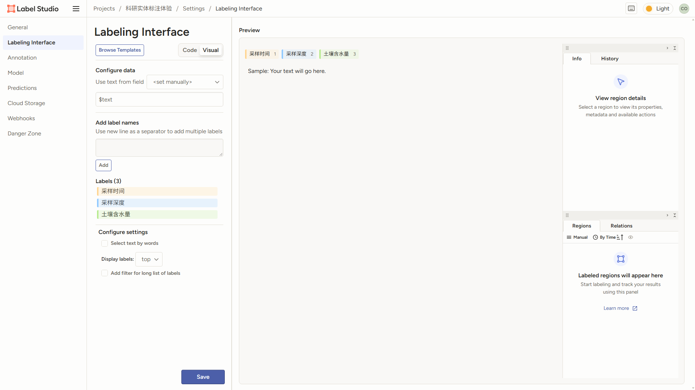

# Label Studio 字段配置体验与字典调整

日期：2026-10-22。按用户授权在本地 Label Studio 注册独立参考账号并登录，查看现有项目的配置与数据列；未修改既有项目、任务或标注。

## 1. 本地实际观察

- 本地入口：[Label Studio](http://127.0.0.1:8080/)。界面标明 Community，登录后可查看现有科研分类、实体与图片标注项目。
- 查看 [科研实体标注体验的配置](http://127.0.0.1:8080/projects/2/settings/labeling)：`Labeling Interface` 提供 `Browse Templates`、`Code / Visual` 切换，左侧配置、右侧预览。
- 可视化配置包括数据字段绑定、按行新增标签、标签列表与界面选项。当前三个标签为采样时间、采样深度、土壤含水量。
- [数据管理页](http://127.0.0.1:8080/projects/2/data) 显示实际业务列 `text`、`sample_id`，列头标出 `str` 类型。
- 通过只读项目接口读取的配置包含 `Text value="$text"`，以及 `Labels / Label` 对应的实体标签定义。另两个项目分别使用 `Choices` 与 `RectangleLabels`。

当前查看的项目设置中没有独立名为“数据字典”的菜单。其相关能力是数据字段绑定和标注界面配置；本项目继续实现用户已确认的“项目业务字段配置”，借鉴编辑与预览交互。

## 2. 本项目对应调整

| 实际参考项 | 本项目实现 | 难度 |
| --- | --- | --- |
| 左侧配置、右侧预览 | 字段编辑与新建数据集业务表单并排显示，选中预览字段可定位其配置 | 中 |
| Visual / Code | 可视化编辑与业务字典 JSON 切换，应用配置后同步预览 | 中 |
| Browse Templates | 科研采样、文献、通用业务模板；也可复制公共字典字段 | 中 |
| 按行添加标签的交互 | 按行批量添加业务字段，自动分配可修改的唯一字段编码 | 低 |
| 标签选项列表 | 枚举值按行填写并以选项展示，右侧使用下拉框预览 | 低 |
| Preview | 文本、数值、日期、枚举、布尔控件预览；显示单位、说明与必填要求 | 中 |
| 项目配置持久化 | 保存至当前项目字典，继续驱动新建数据集与元数据校验 | 中 |

配置 JSON 使用本项目的 `fields` 结构，不是 Label Studio 标注 XML；保留字段类型、枚举、必填、单位和说明。示例填写仅用于预览，不保存为正式数据。数据集编号仍由系统生成，不允许被业务字段占用。

## 3. 保存与边界

JSON 编辑可手动应用，点击创建或保存项目时也会读取当前编辑；格式或字段规则无效时给出原因并阻止保存。重新打开项目弹窗时重新加载字典，避免上一次未保存的代码残留。模板只按需加入，不自动恢复此前移除的作物类型、数据等级或保存方式字段。

本轮实际操作范围为注册、登录和查看本地 Label Studio 界面及只读接口。本项目改动按用户此前要求未运行测试、构建或浏览器回归检查。
