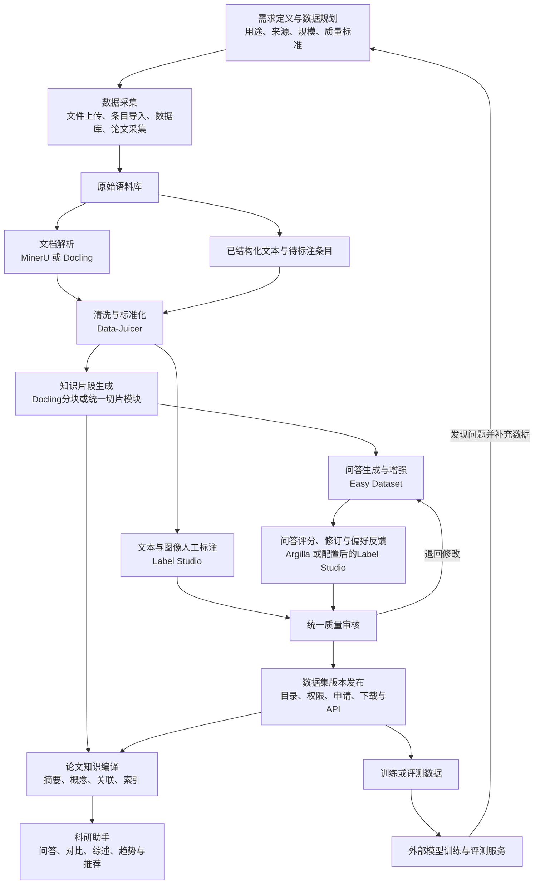

科研资料采集 → 文档解析 → 数据清洗 → 知识片段 → 问答生成与人工标注 → 质量审核 → 版本发布 → 科研知识库或模型应用。

六个平台分布在这条链路的不同位置。下面是建议的集成关系，目前还没有实际打通，也不代表六个平台必须全部采用。

## 1. 完整工作流与模块关系

这里有两条重要分支：

- 知识应用分支： 清洗后的论文和知识片段，可以直接进入知识库，无须先生成训练问答。
- 训练数据分支： 知识片段经过问答生成、标注和审核，形成 SFT、偏好或评测数据。

———

## 2. 按需求阶段看六个平台如何参与

### 2.1 需求定义与数据规划

对应需求：全流程标准、数据字典、清洗流程、规范步骤索引；数据需求定义（数据集名称、使用场景说明、质量要求定义、数据来源说明、数据集类型选择、提交进入采集）；数据规划（类型规划、数据量级规划、数据来源说明）。

先明确：

- 数据用于知识整合、模型训练还是智能体构建。
- 需要文本、图片还是问答对，以及各类数据的比例和规模。
- 数据来源、授权、字段规范与质量要求。
- 清洗规则、标注规范和验收标准。

这一阶段主要由本项目建设。

六个平台中的项目设置、标签配置、处理参数可以承接部分规划结果，但不能替代需求文档要求的业务表单和建设流程。

例如，规划中规定“土壤含水量统一使用百分比”，之后应落实为清洗规则、标注说明和审核条件。

### 2.2 数据采集与原始语料管理

对应需求：文档资料上传、待标注数据上传、实时数据上传、语料预览、语料管理操作、语料统计分析；论文采集对应采集源管理、URL解析、采集规则配置、采集源校验、关键词组合、采集调度、采集监控。

数据入口包括文件上传、待标注条目、MySQL 数据及论文采集。

这一阶段应先保存原始资料及来源信息，再分流处理：

| 输入类型 | 后续路径 |
|---|---|
| PDF、扫描件 | MinerU 或 Docling 解析 |
| Word、Excel 等办公文档 | 评估 Docling，补齐不满足的格式能力 |
| 已有 JSON/JSONL 问答 | 直接清洗或进入标注 |
| 独立图片 | 进入图像标注或视觉模型生成流程 |
| 数据库表格 | 接入后进行字段映射、校验和清洗 |

Easy Dataset、Label Studio、Argilla 都有自己的导入入口，但本项目仍需要统一采集、语料管理和统计入口。论文网站规则配置、采集调度及机构数据库对接，也需要独立实现。

### 2.3 文档解析

对应需求：图片数据清洗（PDF解析）、文档-PDF解析、文档-EXCEL解析、文档-WORD解析，以及论文知识库的全文解析。

MinerU 与 Docling 处于同一层，属于候选解析组件。

| 组件 | 在流程中的主要职责 | 下游需要得到的内容 |
|---|---|---|
| MinerU | 科研 PDF 的正文、版面、表格、公式及图片解析 | 结构化正文、表格、公式、图片与来源信息 |
| Docling | 多格式资料转换为统一文档结构，并支持后续分块 | 文档结构、内容元素、来源位置及素材 |

通常是同一份文件选择一个解析器处理；需要时可对比或设置失败后的替代路线。无需默认将同一 PDF 连续交给两个解析器。

需要注意：

- 需求中的“图片数据清洗”和“文档 PDF 解析”明确共用 PDF 解析能力，可以共用后台服务。
- 表格、图片和公式的正确性仍需要核验。
- Docling 支持部分办公文档，并不等于完整满足需求中的旧格式、样式保留及 Excel 类型推断。

### 2.4 数据清洗与标准化

对应需求：文本-数据清洗，并支撑清洗流程、语料管理操作。

Data-Juicer 主要承担这一阶段的后台加工。

输入是解析结果或已有条目数据，处理包括：

- 清理 HTML、无效字符和重复内容。
- 识别并替换敏感信息。
- 按长度、内容质量等规则过滤。
- 规范字段与内容格式。
- 批量执行规则并输出统计结果。

它与解析模块的关系是：

> 解析模块负责读出内容，Data-Juicer 负责整理这些内容。

农业单位转换、土壤字段映射、业务异常值判定，需要配置或扩展对应规则。图片、表格和公式不能简单按普通文本清理，否则可能破坏科研信息。

### 2.5 知识片段生成

对应需求：知识片段生成。

将清洗后的文档按标题、段落、分隔符和大小限制生成片段。

可以评估 Docling 的结构化分块能力，也可以由本项目提供统一切片模块。Easy Dataset 自带的分块流程可供问答生产使用。

平台应统一保存片段与原文的关系，避免不同工具各自切分后失去关联。至少应保留：

- 原文标识、标题与章节。
- 片段标识及正文。
- 页码或来源位置。
- 关联图片、表格。
- 切片规则与版本。

这些信息同时服务问答生成、原文核对和知识溯源。

### 2.6 问答生成与增强

对应需求：文本问答对提取、SFT问答对增强；部分支撑问答对标注、图像标注。

Easy Dataset 最接近“专业资料转问答数据”的业务流程。

典型路径是：

> 知识片段 → 生成问题 → 生成答案 → 人工修改 → 增强或导出。

在统一平台中，可复用或借鉴它的生成流程，将结果交给后续审核模块。

这里有两个边界：

- 生成的问答属于候选成果，仍需审核。
- 图片描述和图片问答需要视觉模型及图片输入链路。我们已观察到，普通文本问答不会自动附带来源图片，集成时必须明确处理图文关联。

### 2.7 人工标注与质量反馈

对应需求：问答对标注、图像标注、标注结果审核。

Label Studio 与 Argilla 位于这一阶段，存在重叠，可以按任务分工。

| 工具 | 建议承担的任务 | 典型输出 |
|---|---|---|
| Label Studio | 文本分类、实体圈选、图片区域标注，以及配置后的问答标注 | 类别、实体及位置、图片区域、人工填写结果 |
| Argilla | 问答质量评分、可用性判断、答案修订及候选回答排序 | 评分、标签、修订答案、偏好反馈 |

例如，同一篇土壤论文：

- Label Studio 标出采样时间、深度、含水量和图像区域。
- Argilla 展示参考材料、问题与候选答案，收集专家评分和修订。

**两者都可以承接人工标注，项目可以选择一个主工作台，再补充另一类交互。**大模型预标注仍需要连接外部模型和任务调度。

———

## 3. 标注之后还需要哪些模块

### 3.1 统一质量审核

对应需求：标注结果审核。

应将各工具产生的结果汇总到本项目的审核流程：

> 自动检查 → 人工复核 → 通过或退回 → 记录处理结果。

需要区分：

- Argilla 的“已提交”表示反馈已提交。
- Label Studio 的标注结果表示完成一次作业。
- Easy Dataset 的确认保留表示其内部数据选择。

这些状态都不能直接等同于本项目的正式审核通过和成果发布。

需求还要求“自然语言审核要点 → 生成质检代码 → 执行并展示结果”。这一完整功能需要额外建设，代码执行也需要受控运行环境。

### 3.2 版本发布与共享

对应需求：热门数据集成果展示、数据集详情、数据集申请使用、版本控制、目录服务、权限管理、API服务。

审核通过后，统一平台负责：

- 保存原始资料、清洗结果、片段和标注成果之间的关系。
- 问答提取、增强后创建新版本。
- 标记发布版本，展示差异和质量信息。
- 提供目录检索、申请审批、授权下载及数据 API。

六个平台已有的数据集、导出或发布功能只能部分复用。工具内部的发布、文件导出及推送 Hugging Face，都不等于需求中的受控数据资产发布。

———

## 4. 如何连接科研助手平台

需求第 4.6 节要求的论文知识库，需要在解析和清洗结果上继续建设：

> 全文解析 → 结构化摘要 → 概念抽取与归一化 → 跨论文关联 → 全局索引 → 检索问答与分析 → 高质量成果归档。

| 科研助手模块 | 六个平台提供的基础 | 仍需建设的业务能力 |
|---|---|---|
| 文献摘要与结构化编译 | MinerU、Docling 提供全文与结构；Data-Juicer 整理内容 | 全文摘要、背景/方法/结果/结论抽取 |
| 全局索引与知识溯源 | 解析器的来源位置、片段及素材关系 | 概念归一、双向链接、引用展示、更新日志 |
| 深度多维分析 | 清洗后的论文、结构化知识及审核数据 | 跨论文整合、比较、推理与报告生成 |
| 热点趋势与论文推荐 | 可供分析的文献内容和元数据 | 聚类、趋势计算、用户画像和推荐排序 |
| 知识问答与知识积累 | 知识片段、审核后的问答 | 检索、模型回答、来源引用、归档与再次索引 |

**Easy Dataset 生成训练问答，与科研人员在线向知识库提问，是两种不同用途。**前者生产数据，后者需要检索和推理服务。

图表统计分析、方法学撰写、语言润色和 AI4S 实验设计，也需要独立的应用逻辑、专业模板和模型服务；六个平台主要为它们准备数据与知识基础。

———

## 5. 这些模块之间最关键的连接方式

建议由本项目提供统一业务层，通过各工具的接口组织任务，统一记录以下关联：

| 关联 | 作用 |
|---|---|
| 原始文件 → 解析结果 | 能回到原文检查解析错误 |
| 解析结果 → 清洗结果 | 能解释删除、替换和过滤原因 |
| 清洗结果 → 知识片段 | 能追踪片段来自哪里 |
| 知识片段 → 问答/标注成果 | 能核验答案和标签依据 |
| 成果 → 审核记录 → 发布版本 | 能明确谁审核、发布了哪批数据 |
| 发布版本 → 应用或模型评测 | 能追踪应用使用的数据版本 |

特别是文本清洗后，字符位置可能变化，原文坐标、实体偏移和图片引用需要维护映射，不能只复制一份 Markdown 就认为溯源已经保留。

模型实验室则应作为公共能力入口：统一模型配置与权限，为问答生成、自动标注、质量检查、知识编译和科研助手提供调用服务。Argilla 的人工评分可以参与模型评测，但不能替代“模型评测”需求中自动运行、多模型比较和错误分析的完整评测流程。

## 6. 会议上可以这样概括

> 六个平台主要覆盖数据生产链中的解析、清洗、问答生成、人工标注和质量反馈。MinerU 与 Docling 是解析层候选，Data-Juicer 是清洗引擎，Easy Dataset 提供问答生产流程，Label Studio 与 Argilla 提供不同侧重的人工工作台。我们需要在这些组件之上建设统一的数据需求规划、任务调度、审核版本、权限发布和来源追踪，再将加工成果供给论文知识库、科研助手及模型训练评测，形成需求文档要求的完整闭环。
