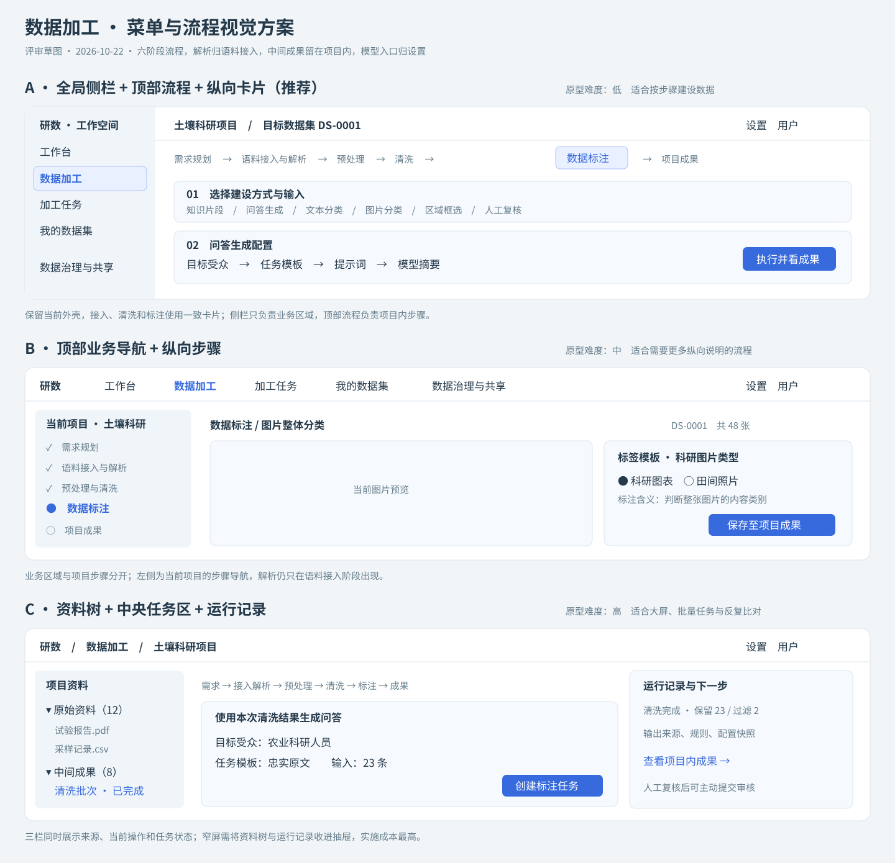

# 非治理模块需求复查与问题清单

复查日期：2026-10-22。

范围：工作台、项目与需求规划、数据采集与语料管理、预处理、清洗、数据标注、项目成果、加工任务及设置。数据治理与共享的内部功能不在本轮验收范围；只检查加工模块与其衔接的入口，没有修改治理页面、目录规则或发布审批逻辑。当前工作区原有改动继续保留。

依据：本次用户建议、第 6 份开发计划、仓库需求与调研资料、当前 `demo/web` 源码，以及只读检查的 `D:/土壤含水量科研数据集-V7.json`。后者为 1 条图片整体分类记录，含内嵌 SVG 图片和“科研图表”人工标签，并非问答数据。本轮未修改该文件。

## 1. 复查结论

页面组织基本符合建议，完整的数据建设能力尚未全部满足。项目上下文、六阶段引导、解析归属、统一数据标注、受众顺序和模型入口迁移已落地。JSON 条目往返、逐条来源和失败重试存在真实问题，本轮已修复；任意字段映射、业务字典贯穿样本处理、复杂标注格式转换与真实引擎接入仍需迭代。

“已实现”限于浏览器本地原型；“部分满足”表示只有部分交互或格式成立；“未接入”表示不具备真实执行能力。固定示例的模型、PDF/Word/Excel 解析、图片质量信息、MySQL 和 SDK 示例均不能计作完整功能。

## 2. 按建议逐项核对

难度分“本地原型补齐 / 正式服务交付”，低指局部表单或纯函数修改，中指多页面和数据关系联动，高指异步服务、资源访问或复杂格式转换。优先级与难度独立：P0 修正数据错误与误导，P1 补建设闭环，P2 接入真实服务，P3 扩展复杂任务。

| 用户要求 | 当前状态与证据 | 剩余工作 | 难度：原型 / 正式 | 优先级 |
| --- | --- | --- | --- | --- |
| 参考 Easy Dataset 与 Label Studio 的数据格式 | 部分满足；`imports.js` 统一 JSON/JSONL、Alpaca 和 ShareGPT；识别 Label Studio 的 `data.text/image` 并保留原始结构 | 自定义字段、Label Studio 控件配置及标注结果的语义适配 | 中 / 高 | P1、P2 |
| 格式质量参考 Easy Dataset 导出 | 部分满足；文件格式和记录结构分开；JSON/JSONL、Alpaca、ShareGPT 可本地导出 | Excel、自定义字段、标签/思维链映射、目标训练框架的导入验证 | 中 / 高 | P1、P2 |
| 多样化导入，按顺序开发 | 部分满足；文件与粘贴条目可用，SDK/MySQL 明确为模拟 | CSV/TSV 字段映射、资源关联，再接数据库与存储连接器 | 中 / 高 | P1 → P2 → P3 |
| 预处理衔接上一步 | 部分满足；实际读取所属数据集的解析结果；结构化条目保留结构，允许跳过清洗 | 缺失字段、类型、单位、必填规则、字段映射和检查报告 | 中 / 高 | P1 |
| 预处理是否完全交给 Data-Juicer | 设计判断：作为清洗执行器合适；平台保留输入准备和总流程 | 适配目标版本、JSONL 中间结构、算子配置、任务队列与日志 | 中 / 高 | P2 |
| 解析归数据采集与语料管理 | 已满足原型组织；`ProcessView.vue` 语料行创建解析任务 | 真正接入解析器、解析修订与结果失效规则 | 中 / 高 | P2 |
| 解析清洗通过 pipeline 引导，而非全局菜单 | 已满足原型组织；`WorkflowSteps.vue` 六阶段，语料内解析，清洗使用纵向卡片 | 明确每个节点的输入快照、可跳过条件和失败恢复 | 中 / 高 | P1、P2 |
| 问答受众在模板前 | 已满足原型交互；`AnnotationWorkbench.vue` 受众先于表达模板，保留手改提示词 | 受众、模板版本及自定义表达模板的维护 | 低 / 中 | P1 |
| 加工中间数据留在项目 | 已满足默认成果路径；任务、清洗及生成结果打开项目内成果 | 建立真实服务下统一的成果引用；主动“提交审核”仍可进入治理 | 中 / 中 | P1、P2 |
| 明确定义数据标注，并提供多种建设方式 | 部分满足；9 种建设入口覆盖切片、生成、增强、文本/图片分类、框选、描述、图片问答及问答复核 | 文本实体、关系、多标注者、复杂任务模板与仲裁；模型能力仍模拟 | 中 / 高 | P1、P3 |
| 模型使用与评测移入用户配置 | 位置已满足；右上角设置可进入模型配置、试用及评测 | 当前为浏览器共享设置，并非不同真实账号独立配置；真实评测未接入 | 中 / 高 | P2 |
| 加工菜单给出视觉方案 | 本轮补 3 套矢量草图，见第 6 节 | 选定后按实际屏幕宽度做交互验收 | 低至高 / 中 | P1 |
| 版本折叠 | 项目成果使用折叠历史，保留版本内容 | 本轮不评价治理目录中的呈现；未来补大量版本的分页 | 低 / 中 | P1 |
| 字典与业务结合，例如数据集编号 | 部分满足；`dataset.code` 生成编号；数据集作用域字段出现在规划表单 | 样本字段绑定、枚举编码、单位/范围校验、不可覆盖系统字段、导出映射与字典版本快照 | 中 / 高 | P1、P2 |
| 数据广场、目录位置和目录范围 | 属治理共享，本轮排除验收；菜单可见目录在广场前 | 继续按本人拥有及获批数据集的独立治理验收处理 | 另行评估 | 本轮不排期 |
| 需求标记难度以便排计划 | 本表及第 5 节补充难度、优先级和验收条件 | 联调前依据具体后端与人员配置估算工期 | 低 / 低 | P1 |

当前项目内流程固定为：需求规划 → 语料接入与解析 → 预处理 → 清洗 → 数据标注 → 项目成果。审核和发布在此流程外，由用户主动提交或进入治理处理，不列为加工菜单的后续自动步骤。

## 3. 本轮发现并修复的问题

| 编号 | 问题与影响 | 修复方式 | 验证 |
| --- | --- | --- | --- |
| F01 | 文件导入与粘贴导入分别映射字段；无效 JSON 可能只保存文件并继续提示成功 | 统一解析与校验；导入前确认对象数组、字段类型及 JSONL 坏行；失败不创建本条文件和成果 | `imports.test.js` 覆盖语法、BOM、空集合、标量及字段类型 |
| F02 | 粘贴条目的成果缺原始语料关联；批量导入部分成功时提示不清楚 | 先分配语料编号，成果绑定来源；展示已成功接入的文件数及失败信息 | 代码核对、构建通过；批量上传浏览器交互待验 |
| F03 | V7 图片分类成果导入后，可能被当作整份 JSON 文本，人工标签无法续用 | 预处理识别结构化条目；分类输入按条投影，保留图片、标签和来源位置 | 使用实际 V7 文件验证 1 条图片和“科研图表”标签；另有自动回归 |
| F04 | ShareGPT 多轮记录缺少往返路径，错误转换可能丢轮次 | 校验已支持的角色和非空消息；ShareGPT 导出保留完整消息数组；Alpaca 遇多轮数据要求明确映射 | 多轮往返测试；尚不代表所有模型工具调用协议兼容 |
| F05 | 切片先合并批次文本，导致每个片段无法定位原资料 | 对每条保留正文分别切片，记录输入成果、资料编号、原记录位置和片段序号 | 纯函数与实际 `runTask` 调度回归；过滤项不进入切片 |
| F06 | 数据集切换时清洗试运行、任务编号和预处理选择可能残留 | 预处理与清洗组件按目标数据集重新创建 | 代码核对、构建通过；真实浏览器切换待验 |
| F07 | 失败任务重试可能继承旧 `id` 或旧输出引用 | 调度器重新生成任务编号，清除旧 `versionId` 并重置执行状态 | 实际调度测试验证编号和输出引用 |
| F08 | 缺失输入或跨数据集引用可能退回示例数据，得到“成功”成果 | 检查当前数据集内来源；增强与自动标注要求对应问答成果；文本清洗不再回退示例正文；未知解析类型失败 | 实际调度测试覆盖缺失及跨数据集输入；其它分支代码核对 |
| F09 | 开发计划仍同时写七阶段和六阶段 | 项目流程统一为六阶段，将正式审核与发布移到项目流程外 | 文档、流程图及当前导航核对 |

Label Studio 的原始 `data`、`annotations`、`predictions` 保留为不同字段，不把模型预测写成人工确认标签。当前只做已知输入字段的基础适配，原始结构导出会保留这些字段；没有宣称本原型已经完整复现 Label Studio 的编辑器或结果格式。

## 4. 继续排查发现的未完成项

以下问题保持公开待办，不能因菜单调整或单元测试通过就标记完成。

| 编号 | 问题 | 证据与影响 | 建议与难度 | 批次 |
| --- | --- | --- | --- | --- |
| R01 | 模型输出仍为固定演示问答/描述 | `store.js` 使用 `qaSamples` 等样例；切换受众或资料不会得到真实模型推理结果 | 接入模型服务、结构校验、失败重试和来源引用；高 | P2 |
| R02 | 预处理无通用字段映射 | `PreparationView.vue` 主要确认输入和预览；CSV 仍是文本，任意 Label Studio 自定义字段只能保留原始结构 | 提供字段映射、类型/单位规则、检查报告及中间结构；中 | P1 |
| R03 | 业务字典尚未贯穿样本处理 | 规划表单只引用数据集级字段；土壤含水量、采样深度等样本字段未统一接入清洗/标注/导出 | 同一份字段契约贯穿导入、标注、检查、导出；中至高 | P1、P2 |
| R04 | 用户设置实际为浏览器共享设置 | 所有演示身份共用 `state.settings`；尚无个人默认值、项目覆盖值与服务端账号隔离 | 明确用户/项目/任务配置优先级，任务保存最终快照；高 | P2 |
| R05 | 原资料改动与结果失效规则不足 | 可编辑资料，但历史解析和导入成果没有源修订号或内容摘要；仍可能使用旧结果 | 为原资料建立修订快照，成果绑定输入修订；重新解析与主动复用旧版本分开；中至高 | P1、P2 |
| R06 | 图片框选输出只存来源编号与框，资源不自包含 | `AnnotationPanel.vue` 保存图片语料编号；脱离本地工作空间后无法据此还原图片；基于展示容器的坐标还需核对实际图像边界 | 资源清单、尺寸与坐标约定、下载包和 Label Studio/COCO/YOLO 独立适配；高 | P1、P2 |
| R07 | 导出覆盖仍不齐 | 未实现 Excel、自定义字段/标签风格；规划允许 Markdown，项目结构导出实际只提供 JSON/JSONL；Alpaca 固定把 reference 映射至 input | 统一规划可选项与导出器能力，增加映射预览及损失说明；中 | P1 |
| R08 | 自检仅固定规则 | 项目成果检查空回答/缺来源和固定词语，质检提示词未转化为实际规则；多模态和分类检查不足 | 加入任务类型对应的结构与业务检查；自定义生成代码执行另列高难度功能 | P1、P2 |
| R09 | Data-Juicer 尚未执行 | 本地规则可运行，图片质量及尺寸为模拟；完整 YAML 和目标版本算子未接入 | 统一规范配置，绑定引擎版本，保留完整配置，服务端执行并返回逐步统计；高 | P2 |
| R10 | 异步任务与身份为前端演示 | 刷新中断任务，角色即演示用户；不是服务端权限边界 | 任务持久化、资源授权、真实身份、队列及取消恢复；高 | P2 |
| R11 | 标签模板缺独立版本及完整标签释义 | 分类成果有模板快照，但无稳定模板版本/类别编码；框选与质量标签仍单独维护 | 任务类型、标签编码、含义、模板版本和规则统一；已有成果保留旧模板 | P1 |
| R12 | 性能与容量边界未验证 | 生产 JS 约 1.21 MB，构建提示大块；文件和内嵌图片存于 IndexedDB，未设大批量导入约束 | 页面按需加载、样本分页、媒体外置、容量和并发测量；中至高 | P2 |

本轮为功能与数据逻辑复查，未开展渗透测试、后端审计或第三方依赖漏洞扫描，不能据此作“无安全漏洞”的结论。

## 5. 建议开发顺序与验收

| 顺序 | 交付内容 | 难度 | 具体完成条件 |
| --- | --- | --- | --- |
| 本轮 P0 | 条目校验、V7 续标、来源保留、重试和缺失输入修复 | 中 | 本报告 F01—F09；自动化部分通过，列明的浏览器交互需补验 |
| 下一批 P1-A | CSV/TSV 与 JSON 自定义字段映射；绑定样本业务字典 | 中 | 采样深度数值/单位、土壤含水量含义/单位、必填和枚举规则可实际校验；错误定位到行与字段 |
| 下一批 P1-B | 标注模板版本、分类/框选质量检查、导出能力统一 | 中至高 | 相同记录往返导入导出，标签编码、图片资源、坐标和问答轮次保持一致；不支持转换时明确说明 |
| 下一批 P1-C | 来源修订、流程输入快照与页面引导 | 中 | 修改原资料后不会默认用旧解析；选定多个输入时范围明确；两数据集来回切换无残留 |
| 后续 P2-A | 解析器、Data-Juicer 与模型服务 | 高 | 用本项目真实文本、表格和图片执行；结果来自本次输入，配置与日志可追溯 |
| 后续 P2-B | 身份、个人设置、队列与文件资源服务 | 高 | 不同用户配置隔离；刷新任务继续；固定输入版本与授权可验证 |
| 后续 P3 | 实体/关系、多标注者、音视频、分割与更多连接器 | 高 | 按实际业务逐类定义任务、标注结构及目标格式，逐项验收 |

这是依赖顺序，不是工期承诺。正式排期前需要确定后端方案、执行环境、目标数据规模和可投入人员。

## 6. 菜单与 pipeline 视觉方案

| 方案 | 组织方式 | 本轮建议 | 原型改动难度 |
| --- | --- | --- | --- |
| A | 保留全局侧栏，项目顶部六阶段，正文纵向任务卡片 | 推荐；与现有实现最接近，先完善输入检查与下一步 | 低 |
| B | 顶部业务导航，左侧当前项目步骤，中央处理与标注表单 | 步骤说明较多时适用；需处理全局菜单与项目步骤的视觉区别 | 中 |
| C | 资料树、中央任务区、右侧运行记录同时展示 | 适合批量加工和来源比对；窄屏需折叠两侧面板 | 高 |

草图只表达布局，不修改正式应用主题。三种方案都遵守：解析放在语料接入，清洗放在项目 pipeline，标注内部区分建设逻辑，结果在项目内查看，模型使用与评测在设置。

## 7. 工具边界与官方资料

以下均为 2026-10-22 查阅官方资料与源码后的设计判断，不表示本轮已部署这些工具。

- Easy Dataset 将 JSON、JSONL、Excel 文件格式与 Alpaca、ShareGPT、自定义字段风格分开。本项目当前只完成其中一部分，不能仅凭同名选项认定导出兼容。[官方导出说明](https://docs.easy-dataset.com/shu-ju-ji/shu-ju-ji-dao-chu)
- Label Studio 的 `data` 是任务输入，人工 `annotations` 与模型 `predictions` 独立；具体字段要与标注配置对应。[任务格式](https://labelstud.io/guide/task_format.html)
- Label Studio 支持多类数据与多种接入途径，各格式的适用路径和版本范围不同；本项目需要分批实现自己的接入器。[官方导入说明](https://labelstud.io/guide/tasks.html)
- Label Studio 原生图片框坐标为图像尺寸百分比；某些导出只带标注，资源打包与格式适配需单独验证。[官方导出说明](https://labelstud.io/guide/export.html)
- Data-Juicer 使用配方组织算子处理与输出，适合清洗执行。根据本项目业务作出的建议是：平台负责接入解析、字段契约、标注、审核衔接与总流程，Data-Juicer 承担可适配的清洗流水线，不把全站业务编排交给它。[官方快速开始](https://github.com/datajuicer/data-juicer/blob/main/docs/tutorial/QuickStart.md)

建议的执行边界：

## 8. 本轮验证与边界

- 改动前：现有 30 项自动化测试通过。
- 改动后：37 项自动化测试全部通过，新增 7 项覆盖条目格式、Label Studio 原始结构、ShareGPT 多轮、V7 分类恢复、逐条切片来源和实际任务调度。
- 实际 V7 文件只读验证通过：1 条分类输入，图片引用保留，人工标签仍为“科研图表”。
- 生产构建通过；存在大块资源提示，列为 R12，不视为构建失败。
- `git diff --check` 通过，三套布局所在 SVG 的 XML 结构校验通过。
- 本轮没有执行新的真实浏览器端到端测试，也没有运行真实 Data-Juicer、解析器、模型或 Label Studio 实例。纯逻辑测试、源码检查、官方资料和真实联调分别记录。

后续浏览器验收应覆盖：上传 V7 → 预处理识别条目 → 跳过清洗 → 图片分类续标 → 保存项目成果；两个数据集切换清洗任务；JSONL 错行、批量部分失败及提示词手改后切换受众。
