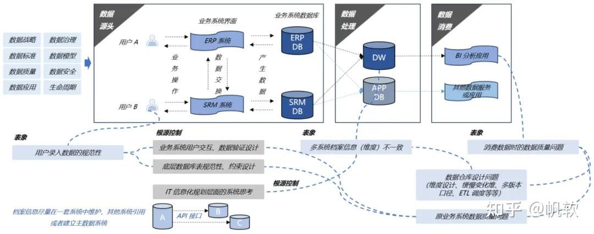
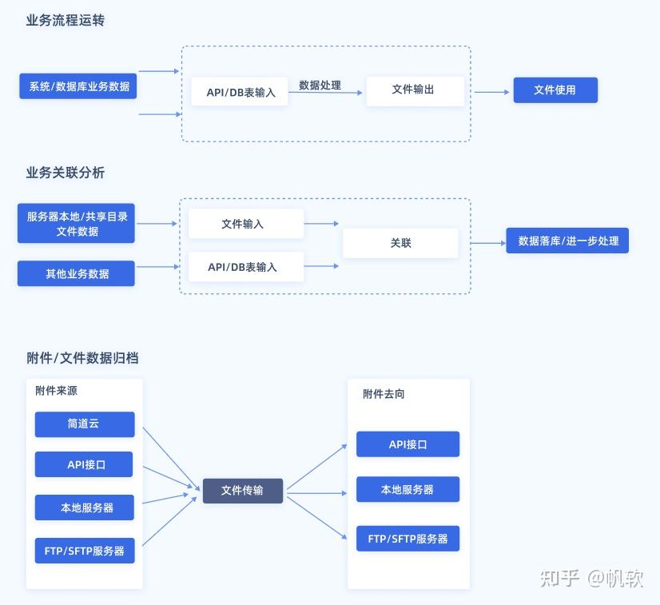
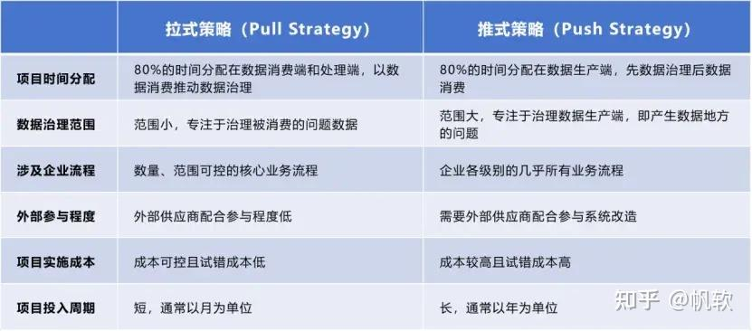
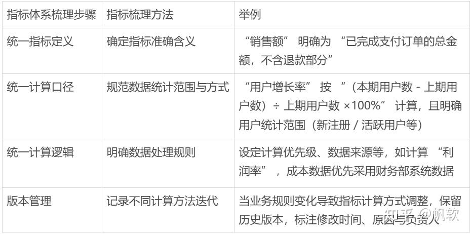
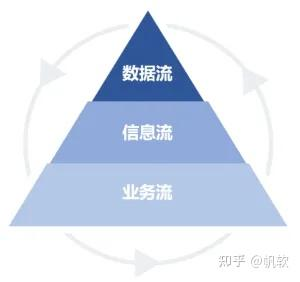

# 终于有人把数据治理讲明白了

> 来源：知乎专栏 · 帆软 | 原文链接：https://zhuanlan.zhihu.com/p/1918966394466328905

这两年，越来越多企业都在喊 “数字化转型”。但实际干起来才发现，数据量大是大了，可**数据对不上、格式不统一、关键数据找不到…… 问题一大堆**。这些让人头疼的状况，其实都和一个核心概念有关 —— **数据治理**。

但很多人一听就觉得复杂难懂，今天我就用最清晰的语言一次性讲明白：**数据治理到底是什么，以及如何用拉式和推式两种务实策略让数据治理真正落地，帮你把混乱的数据管起来、用起来！**

## 一、数据治理是什么？

数据治理，简单来说，就是对数据进行全方位的管理和控制。它包括了从数据的采集、存储、处理到使用的全过程，目的是确保数据的质量、安全、合规和有效性。换句话说，**数据治理就是给数据定规矩、搭架子、做优化。**具体来说，数据治理主要干这么几件事：

### 1.制定数据标准

统一数据的定义、格式和编码，建立安全规范，明确哪些数据能访问、谁能访问、怎么访问。制定质量规则，规定数据必须准确、完整、及时。

### 2.搭建数据平台

搭建数据仓库，把分散在各个业务系统的数据集中存储、管理。开发 API 接口，让不同系统之间的数据能顺畅流通，打破数据孤岛。比如我常用的数据集成与治理工具FineDataLink，可以高效完成小到数据库对接、API对接、行列转换、参数设置等工作，大到任务调度、运维监控、实时数据同步、数据服务API分享也同样能高效实现。另外它可以满足数据实时同步的场景，应有尽有，功能很强大，在我平时进行数据治理工作时帮了不少忙。点击卡片立即体验：

[数据集成与治理工具FineDataLink](https://s.fanruan.com/0n3ja)

### 3.维护数据质量

实时监控数据的流向和质量，一旦发现数据错误、缺失，及时定位问题、修复问题。很多时候，数据出问题，表面看是录入错误，但往深了挖，可能是业务系统设计不合理，或者数据库结构有缺陷。所以，解决数据问题，得从前端录入验证、程序逻辑过滤、数据库约束这三个层面层层把关。

## 二、数据治理的两种策略

考虑到数据治理工程的复杂性，业界总结出了两种目的性不同的数据治理策略：拉式策略（Pull Strategy）和推式策略（Push Strategy）。

### 1.拉式策略

**面向数据应用，是以提升数据应用过程中的数据准确性为目标的数据治理建设策略。**它强调在数据应用的过程中定位和解决问题，以数据应用项目为建设周期。具体而言，拉式策略有三个特点：

**（1）自上而下：**拉式策略通常以指标体系为起点，进行金字塔式自上而下的规划与建设，通过“数据流、业务流、信息流”的过程反向推动数据质量提升；

**（2）数据整合：**它包括多系统的数据整合、拉通、清洗、处理，以及数据仓库建设和ETL 开发过程；

**（3）数据应用：**拉式策略面向数据应用。根据实际业务情况，主要解决数据指标定义标准不清晰、指标计算口径不统一、指标计算口径版本变更、数据不准确、数据上报与数据审核等数据应用场景出现的问题。

### 2.推式策略

**面向数据全生命周期的管理与控制，是一种体系化的数据治理建设策略。**它强调体系化的计划、监督、预防与执行，包括多年计划的数据策略周期。具体而言，推式策略有三个特点：

**（1）体系化、系统化：**推式策略不针对某个单一的、具体的数据应用场景，而是一个全面体系化的治理过程；

**（2）全生命周期：**它贯穿数据全生命周期的管理，例如数据采集、数据质量、数据应用、数据安全、数据分享等多个环节；

**（3）立体策略：**推式策略从数据治理策略（目标、范围、方法和组织 ）开始，通过专业的数据治理团队进行数据治理的规划、实施和监督，通过制定数据管理流程规范从源头业务系统的构建到数据的分发、流转，包括数据安全策略与控制，最终贯穿数据资产管理、分析和挖掘的全生命周期过程。

### 3.策略比较

拉式策略以数据应用需求为起点，推式策略以标准规划为起点，两种策略在多个方面有差异：

根据多数企业的实践经验，以数据应用需求为起点的拉式策略有着更短的实施周期和更低的投入成本，是一种更加灵活、更加敏捷的数据治理策略，我们将在下文中着重介绍这种数据治理策略。

以提升数据应用过程中数据准确性为目标的拉式数据治理建设策略主要包括3个流程：

（1）**基于指标体系的数据问题洞察**：基于数据指标体系，以“数据流、信息流、业务流”的基本逻辑框架，在限定的范围内及时洞察数据质量问题的根源，并逆向推动业务信息化和业务管理的改善和提升；

（2）**稳健的数据架构设计**：通过数据仓库建模、合理的分层设计、ETL 过程开发等，保障数据模型及架构的稳健性和可扩展性，提高数据使用的准确性；

（3）**数据应用审核管控机制**：建立面向高层管理的数据指标管控及审核机制，确保数据应用过程中（上报、可视化分析）关键数据必须经过有效审核，提升数据使用质量及数据准确性。

## 三、如何洞察数据问题

在数据治理落地过程中，精准洞察数据问题是关键的一步。这一过程可以拆解为 5 个步骤：

### 1.资料收集与需求调研

企业要先把内部和数据相关的资料都收集起来，像各业务系统的报表、数据字典等。同时，和业务部门、数据使用方深入沟通，弄清楚大家对数据有哪些需求，平时用数据会遇到什么麻烦。

### 2.指标体系梳理

指标体系包含指标和维度。指标是我们关注的目标，比如销售额、用户增长率；维度则是看数据的不同角度，像按时间、地区、产品分类。梳理时，得统一指标的定义、计算口径和逻辑，还要管理好不同版本的计算方法。

### 3.确认可视化原型设计方案

把梳理好的数据指标，设计成可视化的图表、看板原型。这样能更直观地展示数据，方便业务人员和决策者理解数据，也能提前发现数据展示和分析上的问题。

### 4.问题识别

顺着数据的流向，从指标计算逻辑出发，数据流 - 信息流 - 业务流，一步步检查数据获取情况，再深挖到信息系统和业务管理层面找问题根源。

### 5.形成数据质量提高待办

把前面发现的数据问题整理出来，列成待办清单，明确解决问题的优先级、责任人和时间节点。

## 四、如何发现数据质量问题并进行治理

在以上 5 个步骤里，指标体系梳理和 “数据流 - 信息流 - 业务流” 问题识别尤其关键。数据问题洞察，本质上就是以指标体系为基础，按照 “数据流、信息流、业务流” 的逻辑，在一定范围内快速找到数据质量问题的源头，然后推动业务系统和管理流程改进。具体到三个层面的分析：

### 1.数据流层面

梳理指标体系后，确定好指标计算口径和逻辑，就得顺着这个逻辑去检查数据能不能正常获取。比如计算某个产品的利润率，就要看成本、销售额这些数据在各个业务系统里能不能准确采集到，有没有缺失或者错误。

### 2.信息流层面

要是数据流发现数据获取不了，很可能是信息系统出了问题，比如系统没有设置数据采集功能。这时候，可以先手动补录数据应急，长远来看还是要完善系统建设。通过分析信息流，能找到数据问题更深层的原因，进而优化系统，支持更全面的指标计算。

### 3.业务流层面

排除信息流的问题后，如果数据还有问题，那大概率是业务管理上的问题。比如不同部门对 “客户留存率” 的计算方法不一样，这就是因为部门间职责不清、沟通不到位。从数据流追溯到业务流，企业就能发现业务流程里的漏洞，重新梳理管理流程和部门职责。

## 五、总结

**说到底，数据治理不是简单的技术活，而是企业管理思维的转变。**它要求企业超越技术层面，在组织、流程与标准层面进行系统性构建。通过理解拉式与推式策略的差异，并掌握“数据流-信息流-业务流”的问题溯源方法，企业才能构建可持续的数据管理体系，做到精准决策与业务创新。**数据治理的最终目标，是实现数据价值的可信、可控与可释放，只有真正把数据当成资产来管理，企业才能在数字化时代走得更远。**
